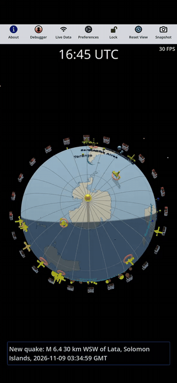

# FlatlandU
November 2026\
Stuart Rankin

A Godot 4.7 port of **FlatlandView** (Stuart Rankin's macOS/SceneKit "Flatland" – day and night on the Earth,
in 3D and flat polar/equirectangular projections). On Windows the UI (toolbar, dialogs, status bar) is
built from Godot Control nodes; on macOS, iOS and Android the dialogs and the button bar are native (SwiftUI and
Jetpack Compose). See [Implementation.md](Implementation.md) for how the project is put together and how to build it.

Animation of FlatlandU running on an iPhone (mirrored to a Mac via Device Hub) in demo mode.\
\

## Methodology
I used Claude to create FlatandU based on FlatlandView (which was written by hand by me)

## Goal
My goal was to have an updated version of Flatland where I can add new features and not worry about deprecated APIs. I chose Godot after using it for BoardTestG. Godot has most of the features I want (lighting, shadows, good 3D model, and the like) and need for Flatland. A bonus was Godot cross-compiles on my Mac so I can build for macOS, iOS/iPadOS, Android, and Windows. Older versions of Flatland only supported Apple products.

### Platforms
Currently, FlatlandU works on the following platforms:
#### macOS
#### iOS
\
#### Android
#### Windows

### Extending Flatland
A feature I wanted to add to the original Flatland was the display of satellites. I never did this due to the press of other concerns. FlatlandU made it straightforward to add satellites to the app.

Other extensions I am considering are: grouping earthquakes to avoid visual clutter, better star background (perhaps with lines delimiting constellations), and maybe adding motion detections (see HUDViewWatch) to update the background realtime.

An earlier version of Flatland had the moon in the overall view as well. That is a good candidate to add back.

## Features

### 3D View
#### Sphere
The earth is shown as a globe with a built-in map wrapped on a sphere. Lighting simulates day and night, and the sphere rotates once a day relative to the light.
#### Cube
I created a cubic shape as well with the map of the Earth plotted on it. This is more whimsy than for any other reason.
### 2D View
For fun, I implemented two-dimensional worlds as well - one is a standard equirectangular map, and two are polar maps (one north-centered and the other is south-centered). All elements are plotted on these maps as well.
#### Maps
The local build has access to many maps but the ones exported to other platforms have only two maps built-in. (They can read maps on mass storage devices however.)
##### Map Formats
All maps used by FlatlandU must be supplied in three formats:
1. Equirectangular (used by the Sphere, Cube, and flat map shapes).
2. North-centered polar.
3. South-centered polar.
In general, the larger the map, the better the end-product looks. However, the larger the map, the larger the binary.
#### Cities
A set of cities is built-into FlatlandU. Cities are shown with various markers to provide context for earthquakes.
### Earthquakes
The feature that is used the most with FlatlandU is seeing new earthquakes. Earthquake data is retrieved from the USGS periodically and new earthquakes are plotted. Earthquakes remain on the map for a set amount of time.
### Stars
This is a new, not fully completed feature that shows the arrangement of the 1000 brightest stars as a background to the main view.
### Satellites
This is also a not yet completed feature that shows various satellites (mainly Earth-observation satellites or space stations or weather satellites). Satellites are show over the map being used and labeled.

## Godot Notes
### User Interface
The user interface from Godot is acceptable on macOS and Windows where there is a great deal of space for the small text chosen by Godot. On smaller devices, the user interface becomes untenable. This required specific instructions to Claude to update how Godot displays on smaller devices, adding more code paths.

Godot cannot use native controls directly, which is to be expected given its goals (games, not user interfaces for non-game utilities). On iOS and Android the dialogs and button bar are therefore drawn by small native plug-ins that Godot talks to (SwiftUI on Apple devices, Jetpack Compose on Android); the details are in [Implementation.md](Implementation.md).

## Implementation and building
How the code is organized (what is shared and what is platform-specific), what has been ported, the development
flags, and the build instructions for every platform are in [Implementation.md](Implementation.md).
