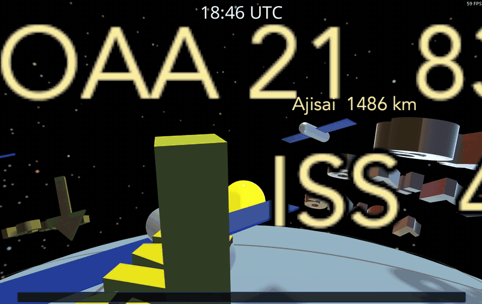
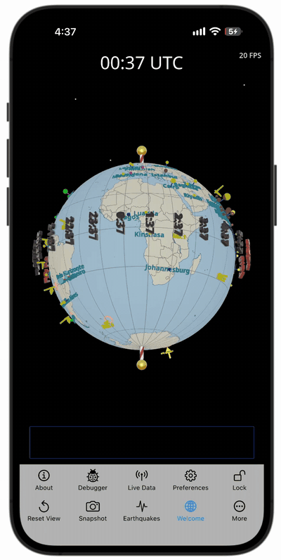
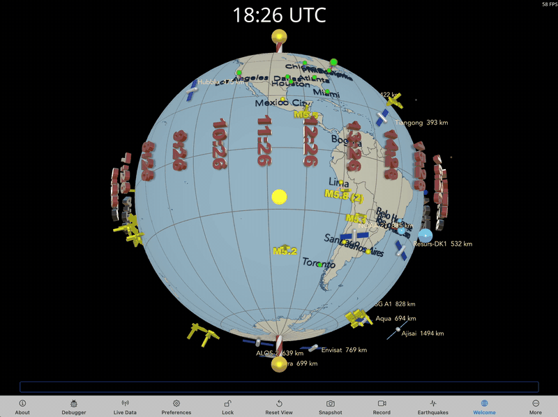
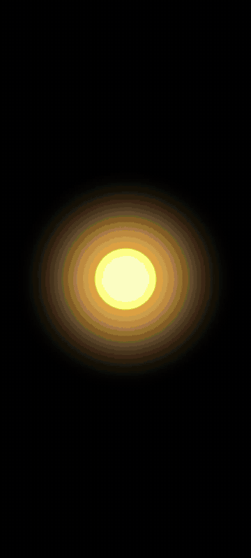
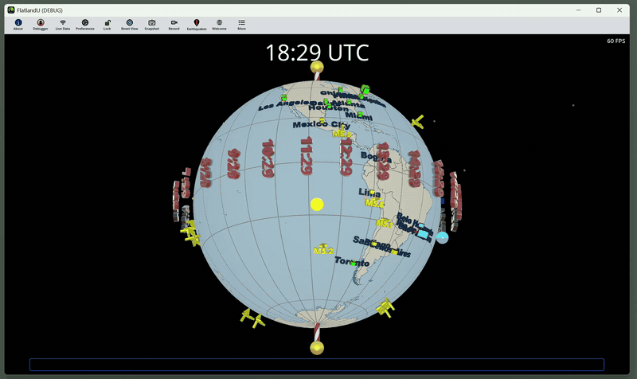
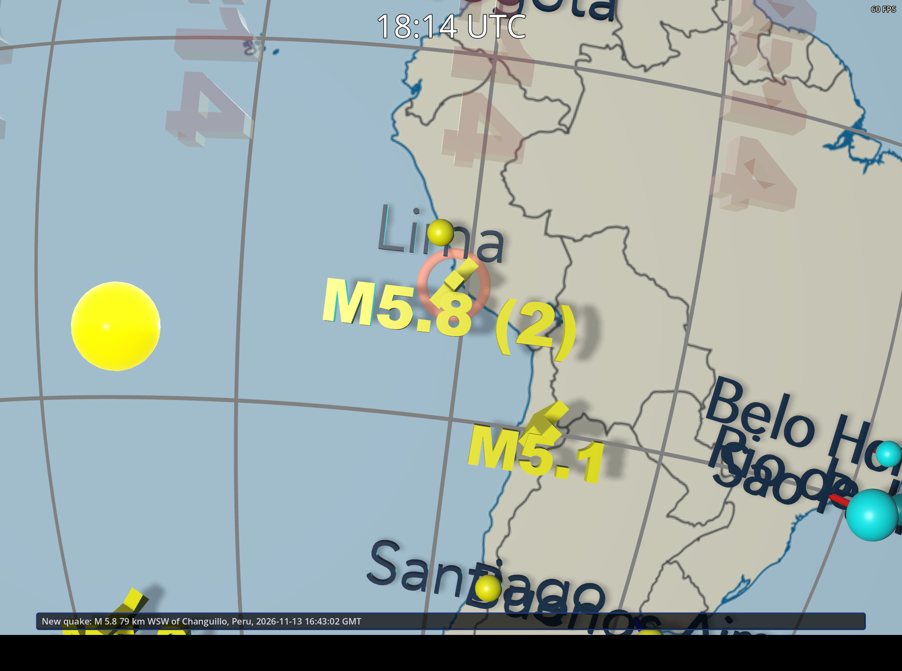

# FlatlandU
November 2026\
Stuart Rankin

A Godot 4.7 port of **FlatlandView** (Stuart Rankin's macOS/SceneKit "Flatland" – day and night on the Earth,
in 3D and flat polar/equirectangular projections). On Windows the UI (toolbar, dialogs, status bar) is
built from Godot Control nodes; on macOS, iOS and Android the dialogs and the button bar are native (SwiftUI and
Jetpack Compose). See [Implementation.md](Implementation.md) for how the project is put together and how to build it.

FlatlandU in "Camera Flight" mode. This is secondary attract mode and flies the camera at low altitude most around the 3D objects.\
\

Animation of FlatlandU running on an iPhone (mirrored to a Mac via Device Hub) in demo mode.\
\

## Methodology
I used Claude to create FlatandU based on FlatlandView (which was written by hand by me)

## Goal
My goal was to have an updated version of Flatland where I can add new features and not worry about deprecated APIs. I chose Godot after using it for BoardTestG. Godot has most of the features I want (lighting, shadows, good 3D model, and the like) and need for Flatland. A bonus was Godot cross-compiles on my Mac so I can build for macOS, iOS/iPadOS, Android, and Windows. Older versions of Flatland only supported Apple products.

### Platforms
Currently, FlatlandU works on the following platforms:
#### macOS

#### iOS

#### Android

#### Windows

## Features
### Earthquakes
The main reason for the existence of Flatland is to show earthquakes. The app relies on the USGS (United States Geologic Service) for real-time earthquake data, refreshed periodically. As new earthquakes are reported, they are plotted on Flatland. As older earthquakes are aged out, they are removed. This happens in the background with no user intervention needed (although functionality is provided to let the user pull the most recent earthquakes.)\

Earthquakes tend to occur in the same geographical area (main earthquake then aftershocks, or earthquake prone areas (Japan)). This can lead to confusing views on Flatland. I added a feature to group earthquakes by geographic region. In the image below, a group of earthquakes all occured in the same general region in Peru. The magnitude of the largest earthquake that hasn't aged out is shown along with the number of other earthquakes in parenthesis.\

### 3D View
#### Sphere
The earth is shown as a globe with a built-in map wrapped on a sphere. Lighting simulates day and night, and the sphere rotates once a day relative to the light.
#### Cube
I created a cubic shape as well with the map of the Earth plotted on it. This is more whimsy than for any other reason.
### 2D View
For fun, I implemented two-dimensional worlds as well - one is a standard equirectangular map, and two are polar maps (one north-centered and the other is south-centered). All elements are plotted on these maps as well.
#### Maps
The local build has access to many maps but the ones exported to other platforms have only two maps built-in. (They can read maps on mass storage devices however.)
##### Map Formats
All maps used by FlatlandU must be supplied in three formats:
1. Equirectangular (used by the Sphere, Cube, and flat map shapes).
2. North-centered polar.
3. South-centered polar.
In general, the larger the map, the better the end-product looks. However, the larger the map, the larger the binary.
#### Cities
A set of cities is built-into FlatlandU. Cities are shown with various markers to provide context for earthquakes.
### Sublunar and Subsolar
The sublunar and subsolar (points on the earth directly under the moon or sun) are optionally shown on the globe and flat maps. The globe shows them with a blue (the moon) or yellow (the sun) sphere on the surface of the globe. The flat maps use images instead.
### Stars
This is a new, not fully completed feature that shows the arrangement of the 2000 brightest stars as a background to the main view.
### Satellites
This is also a not yet completed feature that shows various satellites (mainly Earth-observation satellites or space stations or weather satellites). Satellites are show over the map being used and labeled.

## Godot Notes
### User Interface
The user interface from Godot is fine for development but for general purpose use, not necessarily what is desired. For macOS (which is where the app was developed), I created standard Mac dialogs. This works and looks fine but when showing, the main Flatland UI freezes. Long run, a Godot native UI would work the best.

If the native UI code cannot be used, Flatland falls back to the Godot dialogs.

## Implementation and building
How the code is organized (what is shared and what is platform-specific), what has been ported, the development
flags, and the build instructions for every platform are in [Implementation.md](Implementation.md).
